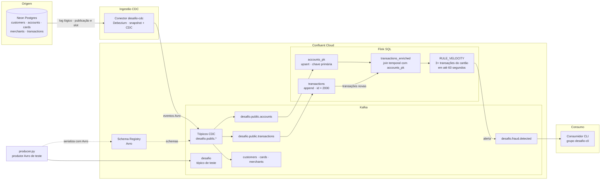
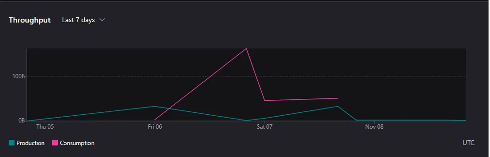
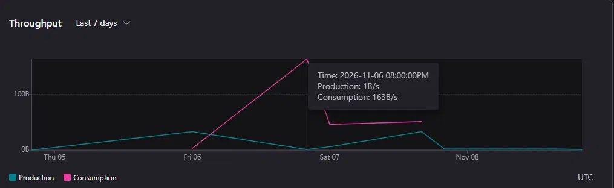
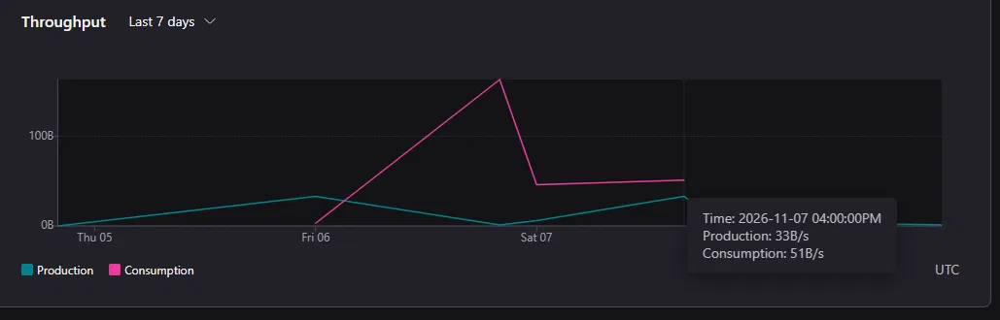
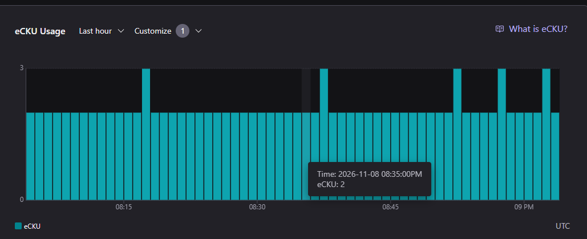
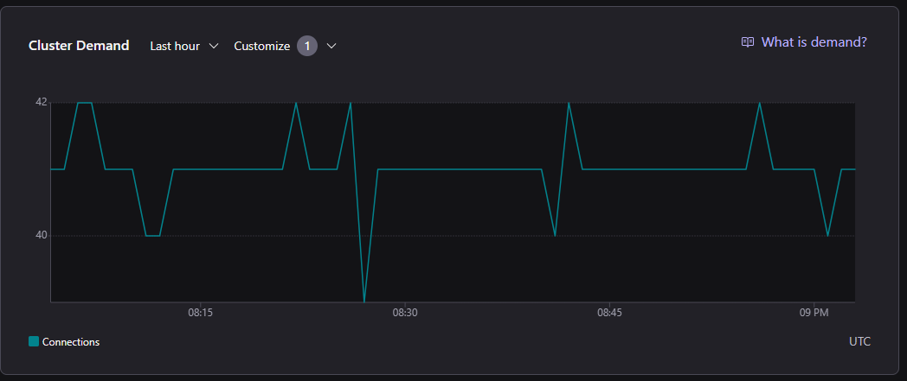
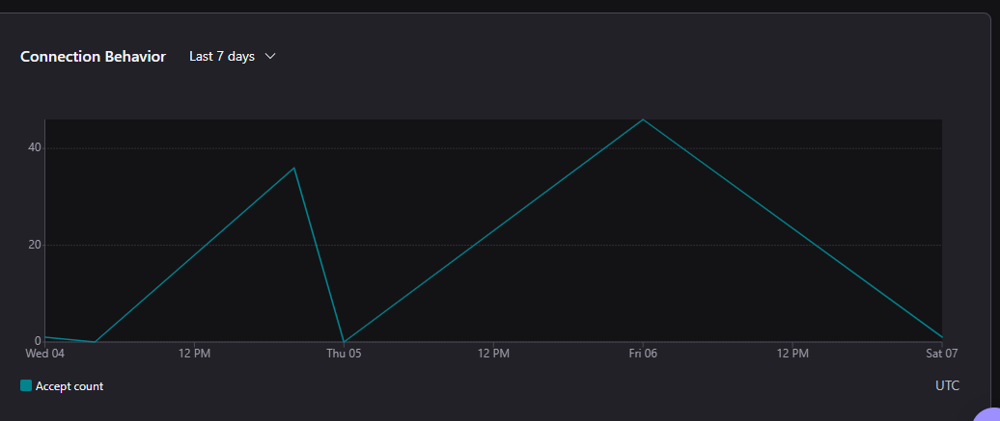
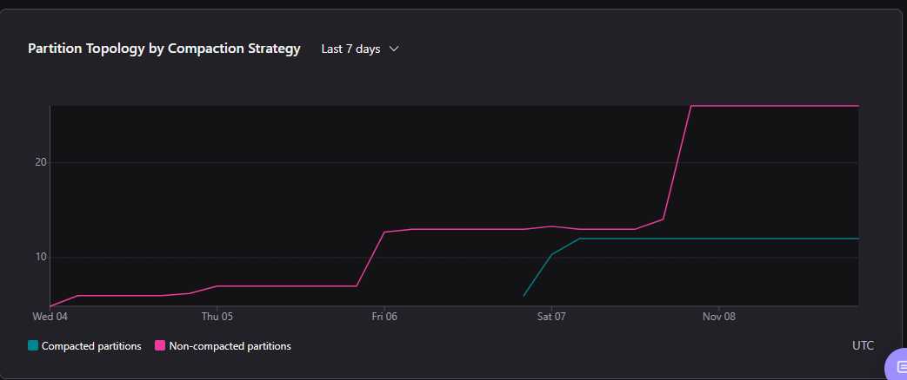

# Pipeline de pagamentos em tempo real: Neon → CDC → Confluent Cloud → Flink SQL

Desafio Final da DIO. Os dados nascem em um Postgres (Neon), entram no Confluent Cloud por CDC (Debezium), passam pelo Flink SQL, que enriquece cada transação com os dados da conta e marca como suspeito o cartão com **3 ou mais transações em 60 segundos**, e seguem para um tópico de alertas.

**Autor:** Leandro Crisci



## Como subir do zero

1. Preencher o `.env` a partir do `.env.example` (nunca versionar o `.env`).
2. Camadas 1 e 2: executar os comandos das seções abaixo, trocando os IDs pelos do seu ambiente.
3. Camada 3: rodar no Neon os scripts de `sql/` (`01-schema-seed.sql` e `02-cdc-prep.sql`, definindo a senha do usuário `cdc_user` só no banco, nunca no arquivo) e então `./setup.sh`, que cria o conector a partir de `connectors/cdc.json`. O script substitui as variáveis com `envsubst`, grava um arquivo temporário e o apaga em seguida.
4. Camada 4: executar no shell do Flink, na ordem, os arquivos de `flink/` (`00` a `03`); os mesmos statements estão na seção da Camada 4.
5. Derrubar tudo: ver "Custo total e teardown".

O `setup.sh` lê `CONFLUENT_ENVIRONMENT_ID` e `CONFLUENT_CLUSTER_ID` do `.env` (ambas listadas no `.env.example`) e só cria o conector. O ambiente, o cluster, as contas de serviço, as ACLs e os schemas são criados pelos comandos das Camadas 1 e 2.


## Estrutura do repositório

```
.
├── README.md
├── setup.sh              # cria o conector CDC
├── teardown.sh           # apaga statements do Flink e o conector
├── producer.py           # produtor Avro de teste
├── requirements.txt
├── .env.example          # modelo das variáveis (o .env não é versionado)
├── .gitignore
├── .gitattributes        # mantém os scripts .sh com quebra de linha LF
├── connectors/cdc.json   # configuração do conector, sem segredos
├── schemas/              # contrato Avro e as versões v2 e v3 dos testes
├── sql/                  # scripts do Neon (Postgres): esquema, seed, preparo do CDC e eventos de teste
├── flink/                # statements do Flink SQL, em ordem (00 a 04)
└── evidencias/           # prints e saídas dos comandos
```

---

## Camada 1: Fundação

O que faz: cria onde o pipeline roda e separa quem escreve de quem lê.

* Ambiente `desafioconfluent` (Stream Governance Essentials) e cluster Basic `desafioconfluent` (AWS us-east-1, zona única)
* `desafio-producer`: `write`, `describe`, `create` nos tópicos com prefixo `desafio` e `__debezium-heartbeat`
* `desafio-consumer`: `read` e `describe` nos tópicos com prefixo `desafio` e `read` nos grupos com prefixo `desafio`

Por que assim: cluster Basic é suficiente para 2000 transações e custa menos. Duas identidades dão menor privilégio: quem lê não consegue escrever.

Comandos para criar a fundação (os IDs são os que o Confluent devolve em cada passo; as chaves de API e os secrets ficam só no `.env`, nunca no repositório):

```bash
# 1. Login sem abrir navegador
confluent login --no-browser

# 2. Ambiente com Stream Governance Essentials
confluent environment create desafioconfluent --governance-package essentials
export CONFLUENT_ENVIRONMENT_ID=<ID do ambiente, formato env-xxxxxx>
confluent environment use "$CONFLUENT_ENVIRONMENT_ID"

# 3. Cluster Basic na AWS (us-east-1)
confluent kafka cluster create desafioconfluent --cloud aws --region us-east-1 --type basic
export CONFLUENT_CLUSTER_ID=<ID do cluster, formato lkc-xxxxxx>
confluent kafka cluster use "$CONFLUENT_CLUSTER_ID"

# 4. Contas de serviço
confluent iam service-account create desafio-producer --description "escreve em desafio*"
confluent iam service-account create desafio-consumer --description "le desafio*"
export SA_PRODUCER_ID=<ID do desafio-producer, formato sa-xxxxxx>
export SA_CONSUMER_ID=<ID do desafio-consumer, formato sa-xxxxxx>

# 5. ACLs do produtor (o conector CDC grava os tópicos e o heartbeat)
confluent kafka acl create --allow --service-account "$SA_PRODUCER_ID" \
  --operations write,describe,create --topic desafio --prefix
confluent kafka acl create --allow --service-account "$SA_PRODUCER_ID" \
  --operations write,describe,create --topic __debezium-heartbeat --prefix

# 6. ACLs do consumidor (só leitura)
confluent kafka acl create --allow --service-account "$SA_CONSUMER_ID" \
  --operations read,describe --topic desafio --prefix
confluent kafka acl create --allow --service-account "$SA_CONSUMER_ID" \
  --operations read --consumer-group desafio --prefix

# 7. Chaves de API (o secret aparece uma única vez: guardar no .env)
confluent api-key create --resource "$CONFLUENT_CLUSTER_ID" --service-account "$SA_PRODUCER_ID"
confluent api-key create --resource "$CONFLUENT_CLUSTER_ID" --service-account "$SA_CONSUMER_ID"
```

Prova de que o menor privilégio funciona na prática: o consumidor, sem informar grupo, recebeu `Group authorization failed`. Com `--group desafio-cli`, que casa com o prefixo permitido, a leitura funcionou.

```text
% Error: Broker: Group authorization failed: FindCoordinator response error: Group authorization failed.
```

Correção feita na revisão: o consumidor tinha, por engano, permissão de escrita em `__debezium-heartbeat`, o que contradiz o menor privilégio. Ela foi removida:

```text
confluent kafka acl delete --allow --principal User:sa-j80pjrm --operations write --topic __debezium-heartbeat --prefix
Are you sure you want to delete the ACL corresponding to these parameters? (y/n): y
Deleted 1 ACL.
```

Depois de remover também `create` e `describe` em `__debezium-heartbeat`, o consumidor ficou só com leitura:

```text
confluent kafka acl list --principal "User:sa-j80pjrm"
     Principal    | Permission | Operation | Resource Type | Resource Name | Pattern Type
------------------+------------+-----------+---------------+---------------+---------------
  User:sa-j80pjrm | ALLOW      | DESCRIBE  | TOPIC         | desafio       | PREFIXED
  User:sa-j80pjrm | ALLOW      | READ      | GROUP         | desafio       | PREFIXED
  User:sa-j80pjrm | ALLOW      | READ      | TOPIC         | desafio       | PREFIXED
```

Identidades do pipeline:

```text
confluent iam service-account list
      ID     |       Name       |     Description
-------------+------------------+----------------------
  sa-j80pjrm | desafio-consumer | le desafio*
  sa-z3ndxk3 | desafio-producer | escreve em desafio*
```

Lista final de ACLs do cluster, depois de apagar as ACLs de teste (`topico` e `teste-value`):

```text
confluent kafka acl list
     Principal    | Permission | Operation | Resource Type |    Resource Name     | Pattern Type
------------------+------------+-----------+---------------+----------------------+---------------
  User:sa-j80pjrm | ALLOW      | DESCRIBE  | TOPIC         | desafio              | PREFIXED
  User:sa-j80pjrm | ALLOW      | READ      | GROUP         | desafio              | PREFIXED
  User:sa-j80pjrm | ALLOW      | READ      | TOPIC         | desafio              | PREFIXED
  User:sa-z3ndxk3 | ALLOW      | CREATE    | TOPIC         | __debezium-heartbeat | PREFIXED
  User:sa-z3ndxk3 | ALLOW      | CREATE    | TOPIC         | desafio              | PREFIXED
  User:sa-z3ndxk3 | ALLOW      | DESCRIBE  | TOPIC         | __debezium-heartbeat | PREFIXED
  User:sa-z3ndxk3 | ALLOW      | DESCRIBE  | TOPIC         | desafio              | PREFIXED
  User:sa-z3ndxk3 | ALLOW      | WRITE     | TOPIC         | __debezium-heartbeat | PREFIXED
  User:sa-z3ndxk3 | ALLOW      | WRITE     | TOPIC         | desafio              | PREFIXED
```

---

## Camada 2: Contrato de dados

O que faz: registra o formato das mensagens no Schema Registry e define a regra de evolução **BACKWARD**: o schema novo precisa conseguir ler dados antigos.

Por que BACKWARD: os consumidores já atualizados continuam lendo o que foi gravado antes da mudança.

* Contrato em `schemas/transaction.avsc`, namespace `com.bootcamp.payments`, com o valor monetário como `bytes` com `decimal(15,2)`. Registrado no subject `desafio-contrato-value` (id 100001).
* O contrato não inclui número de cartão, só `card_id`: o dado sensível nem entra no pipeline.
* Os tópicos do CDC usam os schemas que o próprio conector registra. O `transaction.avsc` é o contrato do `producer.py` de teste.

Comandos para registrar o contrato e definir a compatibilidade:

```bash
# 1. Dados do Schema Registry do ambiente (anotar o ID lsrc-... e o endpoint)
confluent schema-registry cluster describe
export SR_CLUSTER_ID=<ID do Schema Registry, formato lsrc-xxxxxx>

# 2. Chave de API do Schema Registry (guardar o secret no .env)
confluent api-key create --resource "$SR_CLUSTER_ID"

# 3. Variáveis lidas do .env
set -a && source .env && set +a
export SR_URL=$CONFLUENT_SCHEMA_REGISTRY_URL
export SR_KEY=$CONFLUENT_SCHEMA_REGISTRY_API_KEY
export SR_SECRET=$CONFLUENT_SCHEMA_REGISTRY_API_SECRET

# 4. Registrar o contrato no subject desafio-contrato-value
jq -n --rawfile s schemas/transaction.avsc '{schema: $s}' | \
curl -s -u "$SR_KEY:$SR_SECRET" -X POST \
  -H "Content-Type: application/vnd.schemaregistry.v1+json" \
  --data @- "$SR_URL/subjects/desafio-contrato-value/versions"

# 5. Definir e conferir a compatibilidade BACKWARD
curl -s -u "$SR_KEY:$SR_SECRET" -X PUT \
  -H "Content-Type: application/vnd.schemaregistry.v1+json" \
  --data '{"compatibility":"BACKWARD"}' "$SR_URL/config/desafio-contrato-value"
curl -s -u "$SR_KEY:$SR_SECRET" "$SR_URL/config/desafio-contrato-value"
```

Regra de compatibilidade definida e conferida no subject:

```text
PUT  /config/desafio-contrato-value  →  {"compatibility":"BACKWARD"}
GET  /config/desafio-contrato-value  →  {"compatibilityLevel":"BACKWARD"}
```

Os dois testes partem do contrato registrado:

```bash
jq '.fields += [{"name":"channel","type":"string","default":"WEB"}]' schemas/transaction.avsc > schemas/transaction-v2.avsc
jq '.fields += [{"name":"risk_score","type":"int"}]' schemas/transaction.avsc > schemas/transaction-v3.avsc
```

**Aceita: campo novo com valor padrão (v2)**

```text
== v2
{"is_compatible":true,"messages":[]}
```

**Rejeita: campo novo obrigatório, sem valor padrão (v3)**

```text
== v3
{"is_compatible":false,"messages":["{errorType:\"READER_FIELD_MISSING_DEFAULT_VALUE\", description:\"The field 'risk_score' at path '/fields/6' in the new schema has no default value and is missing in the old schema\", additionalInfo:\"risk_score\"}", ..., "{validateFields: 'true', compatibility: 'BACKWARD'}"]}
```

O resultado mostra a regra funcionando: o v3 foi barrado porque um consumidor com o schema novo, ao ler um dado antigo, não teria valor para `risk_score`. No modo BACKWARD, remover um campo é permitido, por isso a rejeição demonstrada é a adição de campo obrigatório.

---

## Camada 3: Ingestão (CDC)

O que faz: o conector `PostgresCdcSourceV2` lê o log do Postgres e publica cada insert, update e delete como evento.

Por que CDC e não batch: os eventos chegam em segundos e sem consultas pesadas no banco.

Pré-requisitos no Neon, verificados:

```text
wal_level = logical
slot:        desafio_slot (pgoutput, ativo)
publicação:  desafio_pub
```

Conector em execução (`evidencias/03-conector-running.txt`):

```text
      ID      |    Name     | Status  |  Type  | Trace
--------------+-------------+---------+--------+--------
  lcc-w7knmvm | desafio-cdc | RUNNING | source |
```

O conector foi recriado com o `setup.sh`, por isso o ID acima é o do conector atual.

Tópicos criados (`evidencias/03-topicos.txt`): `desafio.public.accounts`, `cards`, `customers`, `merchants`, `transactions` e o tópico de heartbeat do Debezium.

Dados do seed no Neon:

| Tabela | Linhas |
| :--- | :---: |
| customers | 200 |
| accounts | 240 |
| cards | 320 |
| merchants | 60 |
| transactions | 2000 |

Configuração do conector (`connectors/cdc.json`). Tudo que é sensível vem de variáveis de ambiente, substituídas pelo `setup.sh`:

* Autenticação com a conta de serviço `desafio-producer` (`SERVICE_ACCOUNT`)
* Usuário e senha do banco em `CDC_USER` e `CDC_PASSWORD`, com SSL obrigatório
* Publicação `desafio_pub` e slot de replicação `desafio_slot`
* Tabelas: `customers`, `accounts`, `cards`, `merchants` e `transactions`
* Formato Avro e `after.state.only=false`, que mantém o envelope completo com `before` e `after`
* Heartbeat a cada 60 segundos (`heartbeat.interval.ms=60000`) e `tasks.max=1`
* `snapshot.mode` não foi definido: vale o padrão do conector, que faz a carga inicial (eventos `op=r`)

Os três tipos de evento, capturados com `INSERT`, `UPDATE` e `DELETE` feitos no Neon (`evidencias/01-envelopes-cdc.json` e `evidencias/01-envelope-update.json`):

| Evento | `op` | O que mostra |
| :--- | :---: | :--- |
| Carga inicial | `r` | `before=null`, `after` com a linha |
| INSERT (loja 61) | `c` | `before=null`, `after` com a loja nova |
| UPDATE (conta 1) | `u` | `before` com saldo 7429.45 e `after` com 7419.45 |
| DELETE (loja 61) | `d` | `before` com a linha e `after=null` |

Observações: o saldo aparece como fração (`"balance":"148389/20"`, igual a 7419.45) porque é assim que a CLI imprime o tipo decimal. A linha `{}` no fim do consumo da loja 61 é o tombstone que o Kafka grava após o delete.

---

## Camada 4: Processamento (Flink SQL)

O que faz: enriquece cada transação com a conta e emite um alerta quando o mesmo cartão faz 3 transações em até 60 segundos.

Por que Flink SQL: join e regra de janela são escritos de forma declarativa, sem infraestrutura para gerenciar.

### Reconhecimento

As tabelas do CDC chegam em modo `retract` (formato `avro-debezium-registry`), sem chave primária, só com a `key` em bytes. Esse fluxo aceita atualizações e exclusões, e o `MATCH_RECOGNIZE` e o `$rowtime` não aceitam isso. A tabela de transações só recebe inserções, então foi convertida para modo `append`:

```sql
ALTER TABLE `desafio.public.transactions` SET ('changelog.mode' = 'append');
SET 'sql.tables.scan.idle-timeout' = '5s';
```

### Passo 1: conta com chave primária

O join temporal exige chave primária na tabela da direita. Esta cópia de `accounts` acompanha as mudanças do banco:

```sql
CREATE TABLE `accounts_pk` (
  PRIMARY KEY (`id`) NOT ENFORCED
) WITH (
  'changelog.mode' = 'upsert',
  'kafka.cleanup-policy' = 'compact'
) AS
SELECT `id`, `customer_id`, `balance`, `status`, `currency`
FROM `desafio.public.accounts`;
```

Conferência: 240 contas, e a conta 1 com saldo 7419.45, que é o resultado do UPDATE de teste.

### Passo 2: enriquecimento da transação

```sql
CREATE TABLE `transactions_enriched` AS
SELECT t.`id`, t.`card_id`, t.`account_id`, t.`merchant_id`,
       t.`amount`, t.`status`,
       a.`customer_id`, a.`status` AS account_status, a.`currency`
FROM `desafio.public.transactions` AS t
LEFT JOIN `accounts_pk` FOR SYSTEM_TIME AS OF t.`$rowtime` AS a
  ON t.`account_id` = a.`id`
WHERE t.`id` > 2000;
```

O filtro `id > 2000` deixa o seed de fora de propósito. O join temporal busca a conta como ela era no horário da transação, e o seed chegou ao Kafka antes do `accounts_pk` existir: nessa primeira tentativa, as 2000 linhas vieram com a conta nula. Além disso, o histórico entraria na regra de fraude e geraria alertas falsos.

Transações de teste, inseridas no Neon: 3 do cartão 201 em sequência e 4 do cartão 58, espaçadas. Resultado do enriquecimento:

```text
id   card_id account_id merchant_id amount status   customer_id account_status currency
2001 201     201        10          120.00 APPROVED 1           ACTIVE         BRL
2002 201     201        11          85.50  APPROVED 1           ACTIVE         BRL
2003 201     201        12          230.00 APPROVED 1           ACTIVE         BRL
2006 58      58         20          99.90  APPROVED 58          BLOCKED        BRL
2004 58      58         20          99.90  APPROVED 58          BLOCKED        BRL
2007 58      58         20          99.90  APPROVED 58          BLOCKED        BRL
2005 58      58         20          99.90  APPROVED 58          BLOCKED        BRL
```

A conta do cartão 58 está `BLOCKED`: é o tipo de informação que o enriquecimento acrescenta à transação.

### Passo 3: regra de fraude `RULE_VELOCITY`

```sql
CREATE TABLE `desafio.fraud.detected` AS
SELECT *
FROM `transactions_enriched`
MATCH_RECOGNIZE (
  PARTITION BY card_id
  ORDER BY `$rowtime`
  MEASURES
    FIRST(T.id) AS primeira_tx,
    LAST(T.id) AS ultima_tx,
    SUM(T.amount) AS total,
    LAST(T.account_status) AS account_status,
    LAST(T.currency) AS currency,
    'RULE_VELOCITY' AS regra
  ONE ROW PER MATCH
  AFTER MATCH SKIP PAST LAST ROW
  PATTERN (T{3,}?) WITHIN INTERVAL '60' SECOND
  DEFINE T AS TRUE
);
```

O padrão procura 3 ou mais transações seguidas do mesmo cartão (`PARTITION BY card_id`) dentro de 60 segundos.

Alerta emitido em `desafio.fraud.detected`:

```text
card_id primeira_tx ultima_tx total  account_status currency regra
201     2001        2003      435.50 ACTIVE         BRL      RULE_VELOCITY
```

As 3 transações que o dispararam e o controle, com o horário de chegada:

```text
id   card_id amount chegada
2001 201     120.00 2026-11-07 16:37:07.845
2002 201     85.50  2026-11-07 16:37:07.846
2003 201     230.00 2026-11-07 16:37:07.846
2004 58      99.90  2026-11-07 16:38:48.521
2005 58      99.90  2026-11-07 16:40:09.273
2006 58      99.90  2026-11-07 16:41:09.710
2007 58      99.90  2026-11-07 16:42:11.250
```

O cartão 201 fez 3 transações em cerca de 1 milissegundo e gerou o alerta. O cartão 58 fez 4 transações com intervalos de 80,8 s, 60,4 s e 61,5 s, nunca 3 dentro de 60 segundos, e **não** gerou alerta.

### Consumo do alerta

O fim do pipeline: o alerta é lido do tópico `desafio.fraud.detected` pela identidade `desafio-consumer`, que só tem permissão de leitura, no grupo `desafio-cli` (prefixo permitido pela ACL):

```text
confluent kafka topic consume desafio.fraud.detected --from-beginning --group desafio-cli --value-format avro --api-key <chave-consumer> --api-secret <secret-consumer>
Starting Kafka Consumer. Use Ctrl-C to exit.
{"account_status":"ACTIVE","card_id":201,"currency":"BRL","primeira_tx":2001,"regra":"RULE_VELOCITY","total":"871/2","ultima_tx":2003}
```

O `total` aparece como a fração `871/2`, que é 435.50: é assim que a CLI imprime o tipo decimal. O alerta recebido é o mesmo do cartão 201 mostrado acima (`evidencias/04-alerta-consumido.json`).

### Problemas encontrados

| Problema | Causa | Solução |
| :--- | :--- | :--- |
| `Table ... does not exist` | Nome de tabela errado | `SHOW TABLES` e crases por causa dos pontos no nome |
| Erro de `$rowtime` em fonte CDC | A tabela `retract` aceita atualizações e exclusões | `ALTER TABLE ... SET ('changelog.mode' = 'append')` na tabela de transações |
| Join temporal devolvendo conta nula | O seed chegou antes do `accounts_pk` existir | Enriquecer só transações novas (`id > 2000`) |
| `Group authorization failed` | O consumidor só lê grupos com prefixo `desafio` | Usar `--group desafio-cli` (menor privilégio funcionando) |

### Limitações

* O horário usado na regra é o de chegada do evento ao Kafka (`$rowtime`), não o `created_at` do banco. Na prática a diferença é de milissegundos, mas conceitualmente são horários diferentes.
* O seed fica de fora do enriquecimento e da regra de fraude.

---

## Camada 5: Operação, as quatro respostas

| Pilar | Resposta (medida) |
| :--- | :--- |
| ① Observabilidade | Painel do cluster: picos de 33 B/s de produção e 163 B/s de consumo, 2 eCKU, cerca de 41 conexões e atraso 0 no grupo `desafio-cli` (seção 5.1) |
| ② Segurança | Duas identidades com menor privilégio: quem escreve não lê, quem lê não escreve (seção 5.2) |
| ③ Custos | US$ 44,83 brutos, cobertos por crédito promocional (valor líquido: US$ 0,00); Flink (48%) e conector (33%) lideram (seção 5.3) |
| ④ Confiabilidade | O elo mais fraco é o consumidor aplicar o efeito do alerta duas vezes (seção 5.4) |

### 5.1 Observabilidade

Medido no painel do cluster `desafioconfluent` (Confluent Cloud, horários em UTC).

**Tráfego, últimos 7 dias.** A linha de produção são os bytes recebidos pelo cluster, e a de consumo, os bytes lidos.



O volume é muito baixo, como esperado para 2000 transações pequenas. Os picos, lidos passando o mouse sobre o gráfico:

| Linha | Valor | Quando (UTC) |
| :--- | :---: | :--- |
| Produção (bytes recebidos) | 33 B/s | 07/11, 16:00 |
| Consumo (bytes lidos) | 163 B/s | 06/11, 20:00 |





O consumo passa da produção porque os mesmos dados foram lidos várias vezes (consultas do Flink e consumidor de linha de comando).

**Capacidade e conexões.**



Na última hora o cluster ficou em 2 eCKU, com picos curtos de 3.



O número de conexões abertas ficou em torno de 41 (entre 39 e 42).





O cluster tem cerca de 26 partições não compactadas e 12 compactadas (as tabelas em modo `upsert`, como `accounts_pk`, usam `kafka.cleanup-policy = compact`).

**Atraso (lag) dos grupos de consumo.** O consumidor usa grupos com prefixo `desafio`, que é o que a ACL permite. O console lista dois: `desafio-cli` (estável) e `desafio-cli-accounts` (vazio).

Depois da leitura do alerta, o grupo `desafio-cli` ficou com atraso total **0**: tudo foi consumido.

No painel do grupo, tópicos, partições e consumidores apareciam como 0 porque não havia consumidor ativo no momento da medição; a medida relevante é o atraso zero.


### 5.2 Segurança

| Identidade | ACLs | Por quê |
| :--- | :--- | :--- |
| `desafio-producer` (`sa-z3ndxk3`) | `create`, `describe` e `write` em `desafio*` e `__debezium-heartbeat*` | O conector CDC cria e grava os tópicos do pipeline e o heartbeat. Não tem permissão de leitura |
| `desafio-consumer` (`sa-j80pjrm`) | `describe` e `read` em `desafio*`; `read` nos grupos `desafio*` | Só lê, e só com grupo de prefixo permitido. O `Group authorization failed` da Camada 1 prova isso |

Cada identidade tem a própria chave de API; as chaves ficam no `.env`, que não é versionado. Durante a revisão, o consumidor tinha uma permissão de escrita indevida, que foi removida (Camada 1).

### 5.3 Custos

Custo bruto dos recursos do ambiente do desafio entre 06/11 e 09/11, vindo de `confluent billing cost list` filtrado pelo ambiente:

```text
confluent billing cost list --start-date 2026-11-06 --end-date 2026-11-10 | grep -E "Start Date|<ID_DO_AMBIENTE>"
```

| Dia | Conector CDC | Flink | Cluster Kafka | Rede | Total (US$) |
| :--- | :---: | :---: | :---: | :---: | :---: |
| 06/11 | 0,50 | 0,168 | 0,135 | 0,0003 | 0,8033 |
| 07/11 | 2,50 | 6,8705 | 1,62 | 0,0059 | 10,9964 |
| 08/11 | 12,00 | 14,5285 | 6,345 | 0,0216 | 32,8951 |
| 09/11 | | | 0,135 | | 0,135 |
| **Total** | **15,00** | **21,567** | **8,235** | **0,0278** | **44,8298** |

| Item | Valor (US$) | Parte do total |
| :--- | :---: | :---: |
| Flink | 21,57 | 48% |
| Conector CDC | 15,00 | 33% |
| Cluster Kafka Basic | 8,24 | 18% |
| Rede | 0,03 | menos de 1% |
| **Total** | **44,83** | |

Créditos promocionais aplicados no mesmo período, em linhas `PROMO_CREDIT` do extrato da conta:

| Dia | Custo do desafio (US$) | Crédito aplicado (US$) |
| :--- | :---: | :---: |
| 06/11 | 0,8033 | 18,8033 |
| 07/11 | 10,9964 | 28,2464 |
| 08/11 | 32,8951 | 32,8951 |
| 09/11 | 0,135 | 0,135 |

Em 08/11 e 09/11 o crédito é exatamente igual ao custo do desafio. Em 06/11 e 07/11 ele também cobriu recursos de outro ambiente da conta, já apagado. Nos quatro dias o crédito cobriu todo o custo do desafio, então o **valor líquido foi US$ 0,00**.

O que aconteceu: o custo deixou de ser centavos a partir de 07/11. O conector rodou 30 tarefa-horas (24 delas em 08/11) e os statements do Flink mantiveram cerca de 2,9 CFU ligados o dia todo em 08/11 (14,5285 ÷ 0,21 ÷ 24), enquanto as evidências eram coletadas; o cluster ficou em 2 eCKU. Em 08/11, conector e Flink somaram US$ 26,53, 81% do custo do dia. Depois da derrubada, 09/11 teve só uma hora de cluster (US$ 0,135).

Duas formas de reduzir o custo:

1. **Derrubar logo depois de coletar as evidências.** O conector cobra por tarefa-hora e o Flink por CFU-hora, e os dois são os maiores itens. Em vez de manter o pipeline ligado entre as sessões de trabalho, rodar o `teardown.sh` assim que as evidências estiverem salvas, e apagar o cluster em seguida.
2. **Ensaiar fora da nuvem.** Testar o conector, o esquema e as consultas em um ambiente local (Docker) e subir a nuvem só para colher as evidências finais. Também vale manter poucos statements contínuos, porque cada um mantém CFUs ligados.

### 5.4 Confiabilidade

| Trecho | O que pode falhar | Como o pipeline reage |
| :--- | :--- | :--- |
| Neon → conector | Conector parado: o slot de replicação retém log no banco | Slot ativo e tópico de heartbeat do Debezium; o slot é apagado no teardown para o banco não acumular log |
| Conector → Kafka | Reenvio de eventos após reinício (entrega pelo menos uma vez) | Tópicos com fator de replicação 3 (`03-topicos.txt`) e contrato Avro no Schema Registry |
| Kafka → Flink | Statement reiniciado | O Flink do Confluent Cloud mantém o estado e a posição de leitura do statement |
| Flink → tópico de alertas | Alerta repetido se houver reprocessamento | Chave natural do alerta: `card_id` + `primeira_tx` + `ultima_tx` |
| Consumidor → efeito | **Elo mais fraco:** aplicar o efeito do alerta (por exemplo, bloquear o cartão) duas vezes | Idempotência é código do consumidor: gravar o efeito pela chave natural do alerta, sem repetir |

---

## Custo total e teardown

Custo declarado: **US$ 44,83** brutos entre 06/11 e 09/11 (detalhe na seção 5.3). Os créditos promocionais da conta cobriram todo o valor: **valor líquido de US$ 0,00**.


Statements Flink e o conector geram custo enquanto rodam. Para derrubar:

```bash
confluent flink statement list --status running
confluent flink statement delete <NOME_DO_STATEMENT>
./teardown.sh
```

No Neon, apagar o slot de replicação, para o banco não acumular log:

```sql
SELECT pg_drop_replication_slot('desafio_slot');
```

Saída do `./teardown.sh` (trecho final): os statements do Flink e o conector foram apagados, e as duas listas terminaram vazias.

```text
   - i-s-c9022fc1-b73c-4bf0-8228-68ffd4056612
Deleted Flink SQL statement "i-s-c9022fc1-b73c-4bf0-8228-68ffd4056612".
🗑 Removendo o conector gerenciado 'desafio-cdc'...
   - lcc-w7knmvm
Deleted connector "lcc-w7knmvm".
📋 Conectores ativos:
None found.
📋 Statements do Flink:
None found.
```

Slot de replicação no Neon, depois do teardown:

```text
SELECT pg_drop_replication_slot('desafio_slot');
ERROR: replication slot "desafio_slot" does not exist (SQLSTATE 42704)
```

O erro confirma que o slot já foi removido: a primeira execução do comando o apagou, e a segunda não encontra mais nada.
